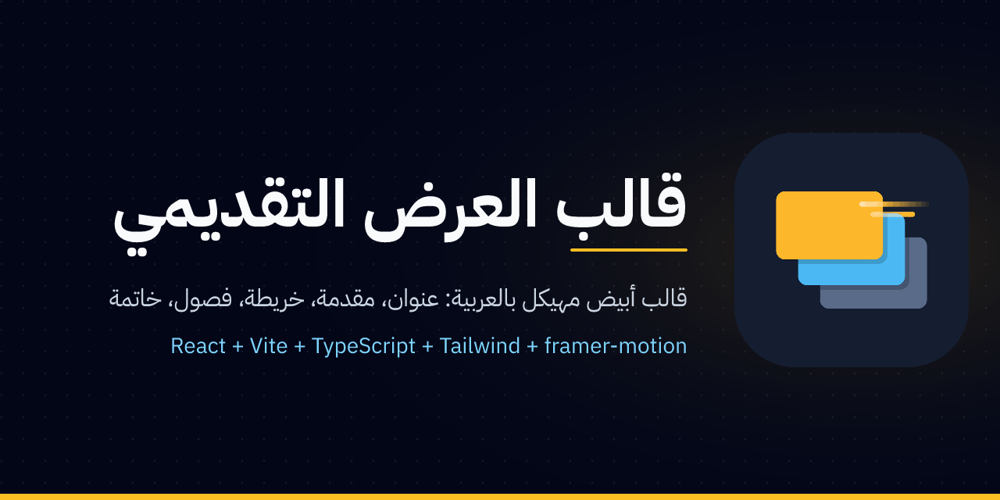
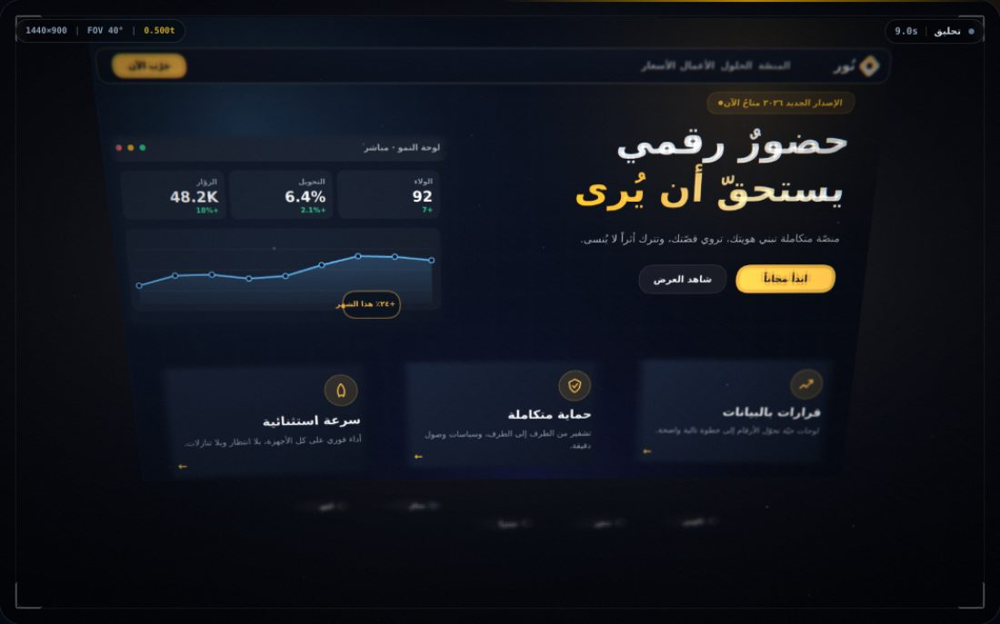

<p align="center">
  
</p>

# قالب العرض التقديمي المهيكل — Presentation Template

<p align="center">
  <a href="https://abdo12-del.github.io/powerpoint/"></a>
  <a href="https://github.com/Abdo12-del/powerpoint/actions/workflows/deploy.yml"></a>
  <a href="https://github.com/Abdo12-del/powerpoint/actions/workflows/ci.yml"></a>
</p>

قالب **أبيض تماماً وجاهز للتعبئة** لأي عرض تقديمي (مذكرة، تقرير، دورة، منتج، دراسة حالة)، يعمل في المتصفح ويطبّق [المواصفة القياسية](docs/PRESENTATION_TEMPLATE_SPEC.md):

```
العنوان ─(ابدأ)─▶ المقدمة (3–4 خطوات) ─▶ خريطة الفصول ─▶ الفصول / الشرائح ─▶ الخاتمة
```

- **React 19 + Vite 7 + TypeScript + Tailwind CSS 4** مع `framer-motion` للحركة و`lucide-react` للأيقونات.
- **RTL أصلاً**: واجهة عربية كاملة بخط Cairo افتراضياً، والشفرة/المعرّفات LTR تلقائياً.
- **29 خطاً عربياً مثبتاً دون اتصال** مصنّفة حسب النوع (كوفي، نسخ، رقعة، حديث، مدوّر، زخرفي + لاتيني وكود) مع **10 اقترانات جاهزة** تُبدَّل من سطر واحد في `src/data/typography.ts`، ومختبر حي `/?lab=fonts`، ومكونات حركة نص آمنة للعربية — [الدليل](docs/TYPOGRAPHY.md).
- **الأنماط العشرة** (§5) كمكونات عامة تستقبل بيانات فقط — [المرجع مع مقتطفات الاستعمال](docs/ARCHETYPES.md).
- **خريطة الفصول تُبنى آلياً** من مصفوفة الفصول، مع تمييز الفصل الحالي ونقطة الاستئناف والشرائح المزارة والشرائح الفارغة.
- **عقد التحكم** كاملاً: أسهم / Enter / Space / Esc / M / F، شريط تقدّم، عدّاد «الشريحة 5 / 12»، فأرة ولمس.
- **تحقق آلي** من قائمة Definition of Done (§10): معرفات فريدة ببادئة الفصل، تمهيد/خلاصة لكل فصل، 3–5 فصول، 4–8 شرائح، عناوين ≤ 6 كلمات، وقائمة بالشرائح التي ما تزال فارغة.
- **عدّة حركة كاملة مثبتة مسبقاً** (GSAP، Lottie، confetti، tsParticles، آلة كاتبة، rough-notation، tilt، auto-animate، tw-animate-css) مع مغلّفات جاهزة في `src/components/effects/` — [الكتالوج](docs/ANIMATION_LIBRARIES.md).
- **موجز للوكلاء** في [`AGENTS.md`](AGENTS.md): كل ما يحتاجه وكيل برمجي ليحوّل القالب إلى عرض مكتمل (مذكرة تخرج، تقرير، دورة…).
- **15 مهارة (Agent Skills)** في `.agents/skills/` (مخرج الحركة، GSAP، framer-motion، المعرض، المخططات، Lottie/الوسائط، الطباعة العربية، حركة النص، الخط يُكتب، الأرقام، الرسوم البيانية، العرض السينمائي، الشورييل الإبداعي، المؤثرات السينمائية، مراجعة الجودة) + **معرض 42 مكوّناً** مستعاراً من Magic UI وmotion-primitives (MIT) في `src/components/gallery/` + **10 وصفات** جاهزة في `src/recipes/` — [الدليل](docs/ANIMATION_PROJECTS.md).
- **مشاريع حركة الخطوط مثبّتة**: HarfBuzz (wasm كسول) لمؤثر «الخط يُكتب» بمسارات SVG حقيقية للعربية (`CalligraphyText`، 10 خطوط قابلة للرسم)، number-flow للأرقام المتدحرجة (`NumberRoll`)، fitty للعناوين التي تملأ الشاشة (`FitText`)، و5 مكونات نصية جديدة في المعرض — [الدليل](docs/TEXT_ANIMATION_PROJECTS.md).
- **الرسوم البيانية وحركاتها**: 6 رسوم حركية مخصّصة بـ RTL أصلي (`MotionBarChart`, `MotionLineChart`, `MotionDonutChart`, `MotionRadarChart`, `Sparkline`, `MotionBarList`) + 4 مكتبات مثبّتة بسمة واحدة ومرايا RTL جاهزة (Recharts عبر حاوية shadcn، Nivo، Chart.js، Apache ECharts — كلها كسولة)، مختبر حي `/?lab=charts`، وصفتا `KpiCards`/`ChartStory`، ومهارة `data-charts-motion` — [الدليل](docs/CHARTS.md).
- **العرض السينمائي ثلاثي الأبعاد**: تحويل صفحة الهبوط (Playwright أو مولّد تجريبي) إلى مشهد WebGL2 بكاميرا على مسار Catmull-Rom، parallax ورفع بطاقات وظلال ناعمة وعمق ميدان، ثم انتقال إلى بطاقة ختامية باسم العلامة وعبارة متحركة — مع معاينة إطارات عند نقاط محددة وتحكم حيّ في المسار والسرعة والعمق وتثبيت أبعاد الصفحة. المختبر `/?lab=cinematic` / `/?lab=flyover` — [الدليل](docs/CINEMATIC_FLYOVER.md) + مهارة `cinematic-flyover`.
- **العرض الإبداعي — Motion Design Showreel (NEW)**: Motion Canvas (MIT) + GSAP — 15 ثانية سينمائية: Kinetic Typography و3D Transitions وParallax وGlitch وMorphing وParticle Effects مع Slide/Zoom وتزامن مع الموسيقى (BPM) وتنسيق بصري جريء — مختبر `/?lab=showreel` ومكون `MotionDesignShowreel` — [الدليل](docs/MOTION_SHOWREEL.md) + مهارة `motion-showreel`.
- **حزمة المؤثرات السينمائية (NEW)**: Three.js (MIT) للمشاهد ثلاثية الأبعاد + Lenis (MIT) للحركة الانسيابية — Parallax وMorphing وGlitch وParticles، تشوهات بصرية (RGB Shift / Grain / Vignette / Bloom) بمرور سينمائي واحد، انتقالات ديناميكية بين المقاطع، وتزامن كامل للحركة مع الإيقاع (BeatClock) — مختبر `/?lab=effects` ومكون `ThreeShowreel` — [الدليل](docs/CINEMATIC_EFFECTS.md) + مهارة `cinematic-effects`.

## القالب الأبيض: ماذا ترى عند التشغيل؟

**لا نصّ في أي شاشة.** كل حقول `src/data/` فارغة وكل `content` يساوي `null`، فتظهر الشاشات الخمس كصفحات بيضاء (بسمة القالب الداكنة) لا يبقى فيها إلا عناصر التنقل: شريط التقدّم، العدّاد، أزرار شريط التحكم، زر البدء (أيقونة)، وخريطة من أيقونات وأرقام. الشاشات **تُخفي عناوينها وشاراتها وتلميحاتها تلقائياً ما دامت بياناتها بلا نصّ، وتُظهرها فور الكتابة فيها** — القرار في مكان واحد: `src/lib/blank.ts`.

| الملف | ما يحتويه | ما تفعله |
|---|---|---|
| `src/data/presentation.tsx` | شاشة العنوان (`meta`)، المقدمة (4 خطوات)، الخاتمة (`final`) — كلها فارغة مع تعليقات تشرح كل حقل | اكتب في الحقول وضع المحتوى مكان `null` |
| `src/data/chapters/ch1.tsx` … `ch3.tsx` | فصل = تمهيد + محوران `placeholder` + خلاصة، كل شريحة `title: ''` و`content: null` | اكتب العناوين، أضف/احذف محاور، ضع مكوّن النمط مكان `null` |
| `src/data/chapters/index.ts` | مصفوفة الفصول | أضف `ch4`/`ch5` إن لزم (الحد 3–5) |

التحقق في وحدة تحكم المتصفح يعرف القالب الأبيض ويطبع تحذيراً واحداً (`template.blank`: «12 شريحة و4 خطوات بانتظار المحتوى»)؛ وبمجرد أن تبدأ التعبئة يصبح كل ما بقي أبيض تحذيراً مستقلاً (`slide.blank`, `preface.blank`, `chapter.title`) ويصبح العنوان بلا محتوى أو العكس خطأً.

## التشغيل

```bash
npm install
npm run dev        # http://localhost:5173
```

| الأمر | الوظيفة |
|---|---|
| `npm run dev` | خادم التطوير (يطبع تقرير التحقق في وحدة تحكم المتصفح) |
| `npm run build` | فحص الأنواع + بناء الإنتاج في `dist/` |
| `npm run preview` | معاينة البناء |
| `npm test` | 189 اختباراً: التحقق (القالب الأبيض + التعبئة الجزئية)، التدفق، عرض كل شاشة/شريحة بلا نصّ ثم معبّأة، الأنماط العشرة، المؤثرات، المعرض، الوصفات، الخطوط، حركة النص، الرسوم البيانية، العرض السينمائي |
| `npm run capture` | التقاط صفحة هبوط وطبقاتها عبر Playwright ← `manifest.json` (يتطلب `npm i -D playwright` و`npx playwright install chromium`) |
| `npm run check` | أنواع + اختبارات + بناء (قبل الدمج) |

## بدء عرض جديد من القالب (الوصفة — §7)

1. **انسخ المستودع** (أو «Use this template» على GitHub) وثبّت الحزم.
2. **استخرج 3–5 أسئلة** يجيب عنها العرض ← كل سؤال فصل: املأ `title`/`subtitle`/`icon` في `chN.tsx` (انسخ `ch3.tsx` لفصل إضافي وغيّر `id` وبادئة معرفات شرائحه).
3. **قسّم كل فصل إلى 4–8 محاور** ← كل محور شريحة؛ انسخ كتلة «المحور»، وحدّث `outline` في `ChapterPreface`.
4. **صنّف كل شريحة** بنمط من العشرة: غيّر `archetype: 'placeholder'` إلى المفتاح المناسب وضع المكوّن مكان `content: null` ([المقتطفات](docs/ARCHETYPES.md)). أثناء الصياغة يمكنك وضع `<Placeholder hint="…" />` مؤقتاً فتظهر كتلة إرشادية مكان الشريحة.
5. **اكتب الأغلفة**: `id` ببادئة الفصل (`ch2-kpis`)، `title` اسم من 3–6 كلمات، `subtitle` اختياري، `icon` دالة.
6. **املأ الشاشات الثابتة** في `presentation.tsx`: `meta` (شاشة العنوان)، `preface` (سياق ← إشكالية كسؤال واحد ← أهداف ← منهجية)، `final` (3–4 جمل تلخيص + دعوة تأمل + شكر). اختر `meta.background` (خلفية جسيمات) و`final.celebrate` (قصاصات الخاتمة؛ `false` للمناقشات الرسمية).
7. **شغّل `npm run check`** — لا يُعدّ العرض مكتملاً ما دام التحقق يحذّر من `slide.blank` / `slide.placeholder` / `preface.blank`.

### الحد الأدنى لشريحة

```tsx
{
  id: 'ch1-profile',
  chapterId: 'ch1',
  title: 'التعريف بالمؤسسة',
  subtitle: 'بطاقة تعريف مؤسسة الدراسة',
  icon: Building2,
  archetype: 'profile',
  content: (
    <ProfileCard
      name="…"
      description="…"
      facts={[{ label: 'التأسيس', value: '2012' }, /* 3–4 حقائق */]}
    />
  ),
}
```

## مكتبات الحركة المثبتة

لا تحتاج إلى تثبيت شيء لبناء عرض غني بالحركة — كل ما يلي في `package.json` وله مغلّف في `src/components/effects/` ([الكتالوج الكامل مع جدول القرار والأمثلة](docs/ANIMATION_LIBRARIES.md)):

| المكتبة | الدور | المغلّف |
|---|---|---|
| `framer-motion` | انتقالات الشاشات، stagger، عدّادات، كشف الكلمات | `Stagger`, `WordReveal`, `motion.*` |
| `gsap` + `@gsap/react` (كل الإضافات: SplitText, Flip, TextPlugin, MotionPath) | تسلسلات زمنية معقّدة داخل الشريحة | `useGSAP`, `GsapReveal`, `splitWords` |
| `canvas-confetti` | احتفال في الخاتمة / إعلان نتيجة | `ConfettiOnMount`, `fireConfetti` — يُفعَّل بـ `final.celebrate` |
| `@tsparticles/react` + `slim` | خلفية نجوم/شبكة/ثلج/فقاعات | `ParticlesBackground` — يُفعَّل بـ `meta.background` |
| `lottie-react` | رسوم Lottie (JSON) دون اتصال | `LottiePlayer` (تحميل كسول) |
| `react-type-animation` | نص يُكتب أمام الجمهور | `Typewriter` |
| `rough-notation` | تحديد/تدوير/تظليل كلمة بخط اليد (RTL) | `Annotate` |
| `react-parallax-tilt` | بطاقة تميل مع المؤشر | `TiltCard` |
| `@formkit/auto-animate` | قوائم تتحرك عند الإضافة/الحذف | `AutoAnimate` |
| `tw-animate-css` | أصناف `animate-in fade-in slide-in-from-bottom-4 …` | مستورد في `index.css` |
| `recharts`, `@nivo/*`, `chart.js`, `echarts` (+ `d3-scale/shape`) | الرسوم البيانية وحركاتها — سمة واحدة ومرايا RTL، كلها كسولة | `@/components/charts` (`MotionBarChart`…, `ChartJs`, `EChart`, `lazyChart`) — [الدليل](docs/CHARTS.md) |

```tsx
import { ConfettiOnMount, Typewriter, Annotate, GsapReveal } from '@/components/effects';
```

الثقيل منها (Lottie ≈ 300KB، tsParticles ≈ 80KB) يُحمَّل كسولاً فلا يدخل الحزمة الأساسية إلا عند الاستعمال. القاعدة §9.5 سارية على الجميع: النص العربي يتحرك بالكلمات لا بالحروف.

## العرض السينمائي ثلاثي الأبعاد

<p align="center">
  
</p>

حزمة `CinematicShowreel` تحوّل صفحة الهبوط إلى مشهد WebGL2 حقيقي بكاميرا متحركة، لا مجرد أنيميشن CSS:

- **الطبقات**: تلتقط بـ Playwright (`scripts/capture-landing.mjs` → `manifest.json`) أو تُولَّد تجريبياً على canvas (`buildDemoLayers`)، ثم تُرفع إلى نُسج WebGL بمحددات `[data-flyover="hero|card|image|logo"]`.
- **الكاميرا**: مسارات جاهزة (`flyover/orbit/dolly/crane/lateral`) أو نقاط مخصّصة `t · position · target · FOV · roll`، باستيفاء Catmull-Rom وتخفيف سينمائي رتيب، مع تذبذب محمول اختياري.
- **الأثر**: parallax بطبقات عمق مستقلة، رفع البطاقات والشعارات مع تتابع وميل، ظل ناعم لكل بطاقة، إضاءة ambient/directional/fill، عمق ميدان باثنتي عشرة عينة bokeh، جزيئات غبار، ثم vignette وحبيبات فيلم في معالجة لاحقة.
- **الختام**: انتقال عند 84% من المدة إلى خلفية البطاقة الختامية، ثم كشف اسم العلامة وعبارتها **كلمةً كلمة** (لا حروف) في طبقة DOM حادّة، مع زر إعادة.
- **المعاينة والتحكم**: مسح زمني بدقة ربع ثانية، سرعة 0.25×–2×، تكرار، ملء شاشة، وشريط إطارات يُصيّر المشهد عند نقاط محددة ويسمح بتنزيلها.
- **تثبيت الأبعاد**: `1440×900` افتراضياً مع `aspect-ratio` و`ResizeObserver`، وكل الطبقات تُحسب نسبةً إلى هذه المساحة فلا يتذبذب الإطار.

```tsx
import { CinematicShowreel } from '@/components/cinematic';
<CinematicShowreel manifestUrl="/captures/landing/manifest.json" />
```

جرّبه من `/?lab=cinematic` (طبقات تجريبية) أو `/?lab=cinematic&captures=/captures/landing/manifest.json` بعد التقاط صفحتك.
التفاصيل الكاملة والـ API: [`docs/CINEMATIC_FLYOVER.md`](docs/CINEMATIC_FLYOVER.md).

## المهارات والمعرض والوصفات

| ما هو | أين | الاستعمال |
|---|---|---|
| **مهارات الوكلاء** (15) | `.agents/skills/<name>/SKILL.md` (و`.claude/skills` رابط) | يحمّلها Claude Code / Codex / Cursor / Copilot تلقائياً؛ أو اطلب «اقرأ مهارة presentation-motion-director» |
| **معرض المكونات** (42، MIT) | `src/components/gallery/` | `import { AnimatedBeam, NumberTicker, TextAnimate, TextEffect, TextLoop, MorphingText, Terminal, Marquee, Meteors, Safari } from '@/components/gallery'` |
| **الوصفات** (10) | `src/recipes/` | `import { StatsCountUp, RelationBeams, TimelineDraw, CodeTerminal, KpiCards, ChartStory } from '@/recipes'` — انسخ وعدّل |
| **كتالوج المشاريع** | `docs/ANIMATION_PROJECTS.md` | مشاريع GitHub للاستعارة لاحقاً مع الرخص وملاحظات العربية |

## الخطوط وأنواعها وحركتها

| ما هو | أين | الاستعمال |
|---|---|---|
| **سجل الخطوط** (29: 11 حديث، 3 كوفي، 5 نسخ، 1 رقعة، 3 زخرفي، 3 مدوّر، Inter، 2 كود؛ 17 منها متغيّرة) | `src/fonts/registry.ts` | `FONTS[id]`, `fontStack()`, `ensureFontLoaded()` — تحميل كسول لكل خط |
| **الاقترانات** (10) | `src/fonts/presets.ts` | `default` · `academic` · `modern-tech` · `corporate` · `editorial` · `heritage` · `kufi-bold` · `friendly` · `geometric` · `maghrebi` |
| **إعداد العرض** | `src/data/typography.ts` | `{ preset: 'academic', display: 'katibeh', latin: 'inter', scale: 1.05 }` — الأدوار: heading (h1–h3) / body / display (`font-display`) / mono |
| **حركة النص** | `src/components/typography/` | `KineticHeadline`, `VariableText` (محاور wght/wdth/slnt/HEXP), `ClipReveal`, `HighlightSweep`, `FancyText`, `FontSpecimen`, **`CalligraphyText`** (الخط يُكتب — HarfBuzz)، **`NumberRoll`** (number-flow)، **`FitText`** (fitty) |
| **مشاريع حركة الخطوط** | `src/lib/text-shaper.ts`, `src/fonts/calligraphy.ts` + `@/components/gallery` | HarfBuzz wasm كسول (≈430KB خارج الحزمة الأساسية)، 10 خطوط قابلة للرسم، و`TextEffect`/`TextLoop`/`TextShimmer`/`MorphingText`/`LineShadowText` — [`docs/TEXT_ANIMATION_PROJECTS.md`](docs/TEXT_ANIMATION_PROJECTS.md) + مهارات `kinetic-typography`, `calligraphy-draw-on`, `numbers-and-counters` |
| **المختبر** | `/?lab=fonts` | الكتالوج حسب النوع + الاقترانات مع تطبيق حي + عروض الحركة (كسول، خارج حزمة العرض) |
| **الرسوم البيانية** | `@/components/charts` + `/?lab=charts` | رسوم حركية مخصّصة (RTL أصلي، framer-motion + d3) ومغلّفات كسولة لـ Recharts/Nivo/Chart.js/ECharts بسمة واحدة — [`docs/CHARTS.md`](docs/CHARTS.md) + مهارة `data-charts-motion` |
| **الدليل والقواعد** | `docs/TYPOGRAPHY.md` + مهارة `arabic-typography-motion` | لا `letter-spacing`/مائل اصطناعي على العربية، حركة بالكلمات والمحاور فقط، أحجام وارتفاعات السطر |

## التحكم أثناء العرض

| المفتاح | الفعل |
|---|---|
| `→` / `Enter` / `Space` | الشريحة التالية |
| `←` | الشريحة السابقة |
| `↓` / `M` / `Esc` | خريطة الفصول (ومن الخريطة `Esc` يعود إلى شاشة العنوان) |
| `F` | ملء الشاشة |
| `?` / `H` | نافذة الاختصارات |

الأحرف العربية المقابلة على نفس المفاتيح مدعومة (`ة` للخريطة، `ب` لملء الشاشة). السحب يميناً/يساراً على اللمس ينقل بين الشرائح. كل المفاتيح في `src/config/controls.ts`.

## بنية المشروع

```
src/
├── types/presentation.ts        # العقود: PresentationData, ChapterData, SlideData, PrefaceStep, FinalData
├── data/                        # ← الاستمارات التي تُملأ لكل عرض (بيضاء تماماً افتراضياً: حقول فارغة و content: null)
│   ├── presentation.tsx         #    شاشة العنوان + المقدمة + الخاتمة
│   ├── typography.ts            #    اقتران الخطوط للعرض (preset + تجاوزات)
│   └── chapters/ch1..ch3.tsx    #    الفصول والشرائح
├── fonts/                       # سجل 29 خطاً (registry.ts) + 10 اقترانات (presets.ts) + applyTypography (apply.ts)
├── components/
│   ├── Presentation.tsx         # يربط آلة الحالة بالشاشات والتحكم
│   ├── screens/                 # الشاشات الخمس: Title, Preface, Map, Slide, Final
│   ├── archetypes/              # الأنماط العشرة + ChapterPreface + ChapterSummary
│   ├── chrome/                  # ProgressBar, ControlBar, SlideHeader, KeyboardHelp
│   ├── ui/                      # Card, Badge/Num/Term, WordReveal (بالكلمات لا بالحروف), Stagger, Placeholder
│   ├── effects/                 # مغلّفات مكتبات الحركة: Confetti, ParticlesBackground, LottiePlayer, Typewriter, Annotate, TiltCard, GsapReveal, AutoAnimate
│   ├── typography/              # حركة النص العربي: KineticHeadline, VariableText, ClipReveal, HighlightSweep, FancyText, FontSpecimen + FontLab (?lab=fonts)
│   ├── charts/                  # الرسوم البيانية: theme + motion/ (6 رسوم مخصّصة) + recharts/ (حاوية shadcn) + nivo/ + chartjs/ + echarts/ + lab/ (?lab=charts)
│   └── gallery/                 # 42 مكوّناً مستعاراً (Magic UI + motion-primitives, MIT) + UPSTREAM.md + LICENSES/
├── cinematic/                   # محرّك WebGL2: camera, shaders, renderer, capture, landing (صفحة تجريبية)
├── recipes/                     # 10 وصفات جاهزة لأنماط الشرائح (تُنسخ إلى content)
├── styles/gallery.css           # إطارات الحركة (@keyframes) لمكونات المعرض
├── hooks/                       # usePresentation (التدفق), useKeyboardControls, useFullscreen, useSwipe
├── lib/                         # navigation.ts, validate.ts (Definition of Done), blank.ts (قرار «الشاشة البيضاء»), gsap.ts (GSAP مُهيّأ + splitWords), motion-prefs.ts, cn.ts
├── config/controls.ts           # خريطة المفاتيح
└── __tests__/                   # validate, navigation, render, archetypes, effects, gallery, recipes, typography, text-shaper, typography-projects, charts
.agents/skills/                   # 15 مهارة (Agent Skills) — .claude/skills رابط رمزي إليها
docs/
├── PRESENTATION_TEMPLATE_SPEC.md # المواصفة الكاملة (البنية، التدفق، الأنماط، الوصفة، القواعد)
├── ARCHETYPES.md                 # مرجع خصائص المكونات + مقتطف استعمال لكل نمط
├── ANIMATION_LIBRARIES.md        # كتالوج مكتبات الحركة: جدول القرار + مثال لكل مكتبة
├── ANIMATION_PROJECTS.md         # المهارات + المعرض + الوصفات + كتالوج مشاريع GitHub
├── TYPOGRAPHY.md                 # الخطوط حسب النوع + الاقترانات + قواعد الطباعة العربية + حركة النص
├── TEXT_ANIMATION_PROJECTS.md    # مشاريع حركة الخطوط المثبّتة (HarfBuzz, number-flow, fitty) + المكونات النصية + ما رُفض
└── CHARTS.md                     # الرسوم البيانية وحركاتها: الرسوم المخصّصة + Recharts/Nivo/Chart.js/ECharts + RTL + المختبر
public/                           # الشعار (logo.png) + favicon.png + apple-touch-icon.png
scripts/
└── capture-landing.mjs          # التقاط صفحة الهبوط وطبقاتها عبر Playwright → manifest.json
.github/
├── workflows/deploy.yml          # نشر تلقائي على GitHub Pages عند كل دفع إلى main (BASE_PATH = /<اسم-المستودع>/)
├── workflows/ci.yml              # فحص طلبات السحب: npm run check
└── social-preview.png            # صورة المعاينة الاجتماعية (1280×640) — تُرفع من Settings → Social preview
AGENTS.md                         # موجز لأي وكيل برمجي يُطلب منه إنتاج عرض من هذا القالب
```

## النشر

- **النسخة الحية**: <https://abdo12-del.github.io/powerpoint/> — تُبنى وتُنشر تلقائياً بسير العمل `deploy.yml` عند كل دفع إلى `main`.
- **تفعيل لمرة واحدة** (لا يمكن عبر API من خارج المستودع): Settings → Pages → Build and deployment → Source: **GitHub Actions**. قبل التفعيل يبقى سير العمل أخضر (بناء + اختبارات + رفع الأداة) ويتخطّى خطوة النشر مع تنبيه؛ بعده شغّله من Actions → «Deploy to GitHub Pages» → Run workflow، أو ادفع أي تعديل إلى `main`.
- **مستودع مشتق أو اسم مختلف؟** لا شيء يُعدَّل: سير العمل يمرّر `BASE_PATH=/<اسم-المستودع>/` إلى Vite؛ محلياً يبقى `base: '/'`. لنشر يدوي على مسار آخر: `BASE_PATH=/my-path/ npm run build`.
- **الشعار**: `public/logo.png` (1024×1024، خلفية شفافة خارج المربع) و`public/favicon.png` و`public/apple-touch-icon.png`؛ وصورة المعاينة `.github/social-preview.png`.

## قواعد لا تُكسر (§9)

- فكرة واحدة لكل شريحة؛ العنوان اسم لا جملة (≤ 6 كلمات).
- الأرقام والمصطلحات تُبرز بـ `<Num>` / `<Term>` / `<Badge>` لا في نص سائب.
- النص العربي لا يُقسَّم إلى حروف في أي حركة — `WordReveal` يقسّم بالكلمات فقط؛ ولا `letter-spacing` ولا مائل اصطناعي على العربية.
- معرفات الشرائح فريدة وببادئة الفصل؛ الخريطة والتنقل يعتمدان عليها.
- الخاتمة تلخّص ولا تُدخل معلومة جديدة.
