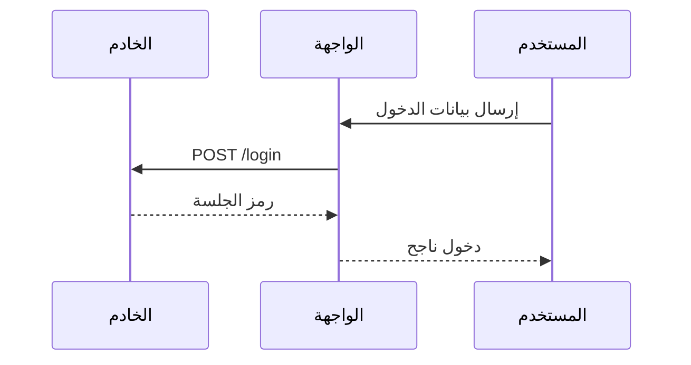
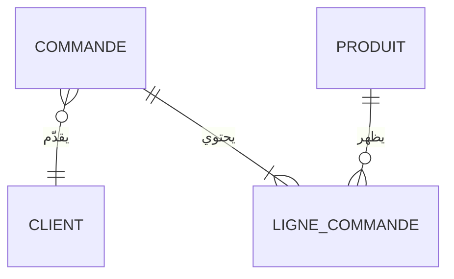
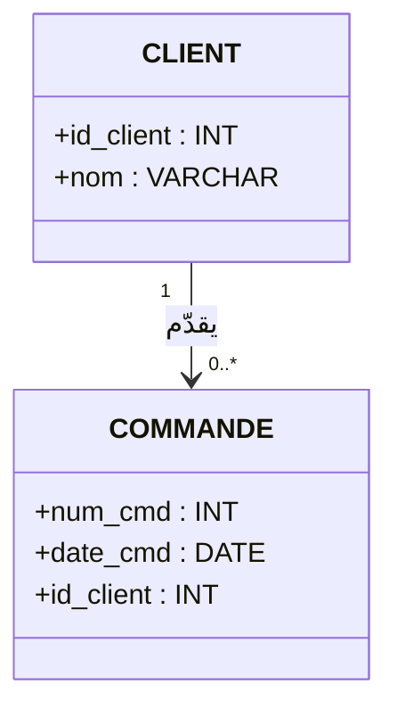

# المخططات التقنية والشفرة (Diagrams & Code)

حزمة للمذكرات والعروض التقنية: مخططات من نص، شفرة قابلة للقراءة، عقد تفاعلية، ورسوم يدوية. لا تضيف نمط شريحة حادي عشر؛ استخدم المكوّن المناسب داخل `content` لنمط `relation` أو `process` أو `tree` أو `code`.

| الأداة | النسخة في `package.json` | الرخصة | متى تُستعمل |
|---|---:|---|---|
| Mermaid | 12.x | MIT | Flowchart، sequence، ERD / MCD، class / UML وغيرها من نص |
| Shiki | 4.x | MIT | تلوين الشفرة، تمييز الأسطر، وdiff |
| `@xyflow/react` | 12.x | MIT | مخططات عقد قابلة للسحب والتكبير |
| `@dagrejs/dagre` | 3.x | MIT | تخطيط آلي للعقد — الاختيار الافتراضي هنا |
| `@excalidraw/excalidraw` | 0.18.x | MIT | رسومات حرة بطابع «بخط اليد» |

المكوّنات الثقيلة محمّلة كسولاً. يتطلب Mermaid 12.2+ Node.js `>=22.12.0`. المختبر الحي: `/?lab=diagrams`. **tldraw غير مثبت**؛ استُبعد لأن رخصته ليست رخصة MIT/مفتوحة تسمح بهذا القالب.

**ملاحظة رخصة انتقالية:** حزمة Mermaid نفسها MIT، لكنها تجلب `elkjs@0.9.3` كتَبَعية متعدية (رخصة EPL-2.0 OR GPL-3.0-or-later). لا توجد تبعية ELK مباشرة ولا يُختار ELK للتخطيط (`layout: 'dagre'`)، لكن قد يتضمن البناء قطعة Mermaid الخاصة به؛ راجع إشعارات التبعيات عند إعادة توزيع المنتج. Dagre هو محرك التخطيط الذي يستعمله `NodeDiagram`.

## Mermaid 12 — مخطط من نص

```tsx
import { MermaidDiagram } from '@/components/diagrams';

<MermaidDiagram
  label="مسار معالجة الطلب"
  minHeight={320}
  source={`flowchart RL
    A[طلب جديد] --> B{البيانات مكتملة؟}
    B -- نعم --> C[تأكيد الطلب]
    B -- لا --> D[استكمال البيانات]
    D --> B`}
/>
```

`MermaidDiagram` يطبّق تلقائياً سمة القالب الداكنة (slate + amber + sky)، خط العربية، ووسوم RTL (`dir=auto` مع `unicode-bidi: plaintext`). تضبط الروابط بعد التخطيط وتُرسم بالتتابع؛ يتوقف الرسم عند تفعيل `prefers-reduced-motion`. وضع `securityLevel: 'strict'` و`maxTextSize` و`maxEdges` ثابت في `src/components/diagrams/theme.ts`.

### نماذج مناسبة للمذكرات



في مخطط التسلسل تُعرض الأطراف حسب ترتيب التصريح، من اليسار إلى اليمين. اكتب ترتيب المشاركين معكوساً كي يكون المستخدم/البداية في يمين اللوحة عندما يكون اتجاه القراءة عربياً.



ويمكن صياغة MLD/UML بـ `classDiagram`:



يمكن استعمال `erDiagram` لعرض MCD، و`classDiagram` أو `flowchart` لشرح MLD/معمارية النظام. اتبع قاعدة: **فكرة واحدة لكل شريحة**، ولا تزدحم العقد أو الأسطر؛ قسّم المخطط الكبير على شرائح.

للاستعمال في ملف فصل:

```tsx
{
  id: 'ch2-mcd',
  chapterId: 'ch2',
  title: 'النموذج المفاهيمي للبيانات',
  icon: GitBranch,
  archetype: 'relation',
  content: <MermaidDiagram source={mcdSource} label="النموذج المفاهيمي للبيانات" />,
}
```

## Shiki 4 — `CodeBlock` ملوّن

`CodeBlock` الحالي أصبح مغلّفاً لـ Shiki: يبدأ بنص آمن عادي، ثم يحمل الملوّن والقواعد المطلوبة عند العرض. النمط الداكن `github-dark` ينسجم مع القالب، والـ tokens تُعرض بعناصر React (لا `dangerouslySetInnerHTML`).

```tsx
import { CodeBlock } from '@/components/archetypes';

<CodeBlock
  title="schema.sql"
  language="PostgreSQL"
  highlightLines={[2, 4]}
  revealLines
  code={`CREATE TABLE commande (
  num_cmd BIGSERIAL PRIMARY KEY,
  date_cmd TIMESTAMP NOT NULL DEFAULT now()
);`}
/>
```

| الخاصية | الوظيفة |
|---|---|
| `language` | لغة Shiki (مثل TypeScript، SQL، Python، JSON، Bash، HTML/CSS)؛ القواعد الشائعة تُحمّل عند الطلب |
| `highlightLines` | أسطر 1-based لإبرازها |
| `diff` | تفعيل Unified Diff؛ أضف `language` لتلوين محتوى السطر المعدّل بلغة المصدر |
| `revealLines` | كشف الأسطر بالتتابع عند دخول الشريحة، افتراضياً `true`؛ يحترم تقليل الحركة |
| `aside` | تفسير عربي جانبي كما في API السابق |

```tsx
<CodeBlock
  language="TypeScript"
  diff
  highlightLines={[4]}
  code={`@@ -1,3 +1,3 @@
-  status?: 'draft';
+  status: 'draft' | 'approved';`}
/>
```

إذا لم تُحدّد لغة مع `diff`، تظل علامات الإضافة والحذف والترويسات واضحة حتى دون تلوين قواعد اللغة. إذا فشل تحميل لغة غير شائعة، يظهر النص الأصلي بدلاً من إخفائه.

## React Flow + Dagre — عقد تفاعلية

استخدم `NodeDiagram` عندما يحتاج القارئ إلى فحص عقد كثيرة أو تغيير مواضعها بالسحب؛ واجهة React Flow والـ CSS والـ Dagre في قطع كسولة.

```tsx
import { NodeDiagram } from '@/components/diagrams';

<NodeDiagram
  pattern="process"                 // tree | relation | process
  direction="RL"                    // اتجاه القراءة العربي
  layout="dagre"                    // dagre | manual
  interactive
  animatedBeams                     // طبقة AnimatedBeam الموجودة في المعرض
  nodes={[
    { id: 'request', label: 'استلام الطلب', kind: 'start' },
    { id: 'check', label: 'فحص البيانات' },
    { id: 'complete', label: 'مكتمل؟', kind: 'decision' },
    { id: 'accept', label: 'تأكيد الطلب', kind: 'end' },
  ]}
  edges={[
    { source: 'request', target: 'check' },
    { source: 'check', target: 'complete' },
    { source: 'complete', target: 'accept', label: 'نعم' },
  ]}
/>
```

- `tree` يختار `TB` افتراضياً، و`relation`/`process` يختاران `RL` (يمين ← يسار). غيّر `direction` إذا كان شكل البيانات يتطلب ذلك.
- العقد تدعم `default | start | end | decision | entity`، مع `description` اختياري. الحواف تدعم `label` و`animated`.
- `interactive` يفعّل السحب، التكبير/التصغير، وإنشاء حافة من مقابض العقد. تغييرات المستخدم مؤقتة في العرض؛ إذا أردت حفظها فاحفظ بياناتك في state خارجي.
- `animatedBeams` يرسم `AnimatedBeam` فوق الحواف بتأخير تراكمي، ويتوقف عند `prefers-reduced-motion`.
- `layout="manual"` يستعمل `position: { x, y }` من كل عقدة. دالة `layoutWithDagre()` متاحة إذا أردت مواضع آلية مستقلة عن مكوّن العرض.
- اخترنا Dagre (MIT) بدلاً من إضافة تخطيط ثانٍ إلى التطبيق؛ لا توجد تبعية مباشرة لـ ELK.

لا تضع أكثر من 8–10 عقد/روابط في شريحة مناقشة واحدة. راعِ أن شاشة اللمس تحتاج أهدافاً كبيرة ولا تجعل عقدة القرار تقطع النص العربي.

## Excalidraw — رسوم «بخط اليد»

`ExcalidrawBoard` يوفّر محرر Excalidraw مُوطّناً بالعربية (`ar-SA`) وبسمة داكنة. وضع القراءة فقط هو الافتراضي؛ `editable` يفتح أدوات الرسم في المختبر أو الشريحة التي تحتاج التحرير.

```tsx
import { ExcalidrawBoard } from '@/components/diagrams';

<ExcalidrawBoard
  elements={[
    { type: 'rectangle', x: 80, y: 100, width: 180, height: 100, label: { text: 'الواجهة' } },
    { type: 'ellipse', x: 360, y: 100, width: 200, height: 100, label: { text: 'قاعدة البيانات' } },
    { type: 'arrow', x: 260, y: 150, points: [[0, 0], [90, 0]] },
  ]}
  height={460}
/>
```

`elements` يقبل هياكل Excalidraw المبسّطة وتحوّل إلى scene عند تحميل المكوّن؛ أو مرّر `initialData` بمشهد مُسلسل. لاستقبال التعديلات والحفظ، فعّل `editable` واستعمل `onChange(elements, appState, files)` لتخزين المشهد خارجياً. المكوّن يحمّل CSS/runtime داخل chunk منفصل.

## الاختيار السريع

| الحاجة | ابدأ بـ |
|---|---|
| تدفق/تسلسل/ERD ثابت قابل للتخزين في Git | `MermaidDiagram` |
| شفرة، SQL، MLD نصّي أو لقطة diff | `CodeBlock` (`Shiki`) |
| عقد تُسحب أو تُفحَص أثناء المناقشة | `NodeDiagram` (`React Flow + Dagre`) |
| رسم مفاهيمي/توضيحي حرّ بخط يد | `ExcalidrawBoard` |
| شعاع زخرفي بين عقد HTML بسيطة | وصفة `RelationBeams` الموجودة (`@/recipes`) |

الدليل يكمّله مرجع الأنماط [`ARCHETYPES.md`](./ARCHETYPES.md) ومهارة الوكيل [`technical-diagrams-code`](../.agents/skills/technical-diagrams-code/SKILL.md). اختبارات القواعد والتخطيط والتلوين في `src/__tests__/diagrams.test.tsx`.
